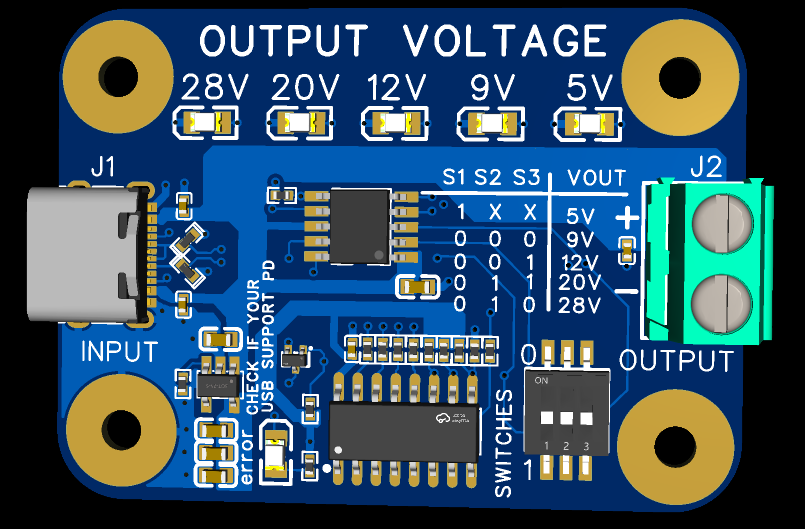
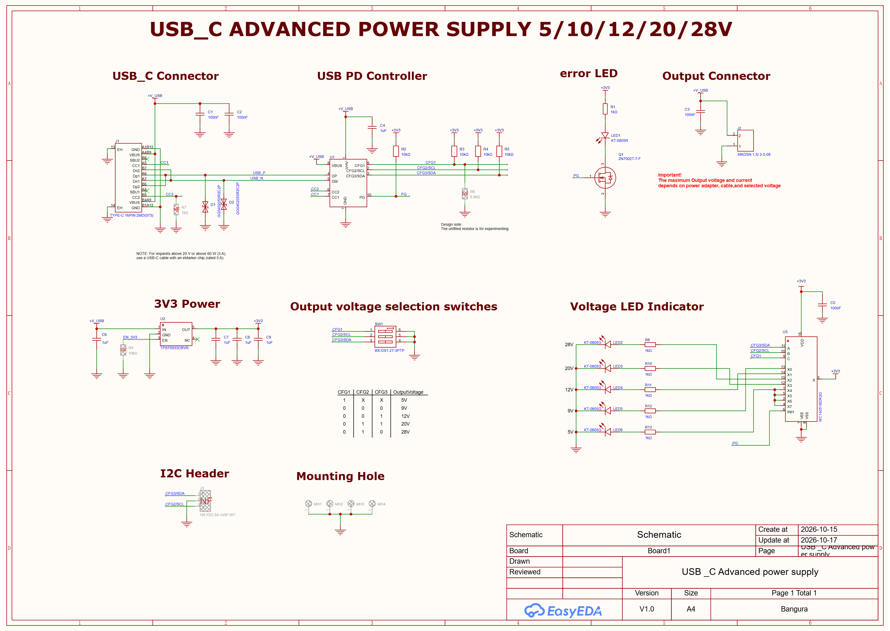

<p align="center">
  
</p>

# CH224A USB-C PD Advanced Power Supply Board

A USB-C Power Delivery (PD) sink board built around the **WCH CH224A**. It negotiates a voltage with a USB PD charger and provides it on an output terminal. The voltage is selected with on-board switches (no microcontroller needed), and LEDs show which output voltage is selected.

Designed in **EasyEDA Pro** by **Bangura Electronics & PCB**.



> **Status: design only. The board has not been built or tested yet.**
> The schematic and layout are complete and the output files are included, but nothing here has been verified on real hardware. Check the design yourself before ordering or using it.

## Features

- USB-C female receptacle input
- CH224A PD sink controller, no MCU required
- Selectable output voltage: **5 V, 9 V, 12 V, 20 V and 28 V**
- Voltage selection with switches S1, S2 and S3
- LED indicators for the selected output voltage
- Output terminal (J2) with GND
- Designed for up to **5 A (100 W)** output
- 4-layer PCB with mounting holes

## Schematic



The full schematic is also available as a PDF in `outputs/schematic.pdf`.

## Voltage selection

Set the switches according to the table printed on the schematic and on the board silkscreen:

| S1 (CFG1) | S2 (CFG2) | S3 (CFG3) | Output voltage |
|:---------:|:---------:|:---------:|:--------------:|
| 1 | X | X | 5 V |
| 0 | 0 | 0 | 9 V |
| 0 | 0 | 1 | 12 V |
| 0 | 1 | 1 | 20 V |
| 0 | 1 | 0 | 28 V |

`1` = high, `0` = low, `X` = don't care. Please verify this table against the CH224A datasheet and the schematic before building.

## Charger and cable requirements

The CH224A can only **request** a voltage. The charger decides whether to give it, so:

1. **Use a USB PD charger.** A basic 5 V charger (or one that only supports Quick Charge or other non-PD protocols) cannot answer the request, and the output stays at 5 V.
2. **The charger must offer the voltage you select.** Check the charger label for the voltage list, for example `9V/3A, 12V/3A, 15V/3A, 20V/3A`. If the selected voltage is not listed, the request fails.
3. **28 V needs a PD 3.1 (EPR) charger.** Most chargers do not offer 28 V.
4. **Above 20 V or above 60 W (3 A), use a 5 A USB-C cable with an eMarker chip.** Without an eMarker, the charger limits itself to 20 V and 3 A.
5. Up to 20 V and 3 A, any standard USB-C cable works.

The board uses a female USB-C receptacle, so the eMarker comes from the cable. The CH224A simulated eMarker function (datasheet section 5.3) is **not used**, and no 1 kΩ resistor is placed on CC2.

## Repository structure

```
.
├── README.md
├── CH224A-USB-PD-Board.step         3D model (STEP)
├── hardware/
│   └── CH224A-USB-PD-Board.epro2    EasyEDA Pro project (schematic + PCB)
├── fabrication/
│   ├── gerber.rar                   Gerber files for fabrication
│   └── PickAndPlace.xlsx            Pick and place (component placement) file
├── outputs/
│   ├── bom.xlsx                     Bill of materials
│   ├── schematic.pdf                Schematic
│   └── pcb.pdf                      PCB layout
└── images/
    ├── logo.png
    ├── SCH.png                      Schematic image
    └── PCB.png                      PCB layout image
```

## How to open the design

1. Open [EasyEDA Pro](https://pro.easyeda.com/).
2. Go to **File → Open Project** and choose `hardware/CH224A-USB-PD-Board.epro2`.

## How to order the board

1. Upload the Gerber archive from the `fabrication/` folder to a PCB manufacturer (for example JLCPCB).
2. Select a 4-layer board with the thickness and finish you prefer.
3. For assembly, use `outputs/bom.xlsx` and the pick and place file in the `fabrication/` folder.

## Safety notes

- This board handles up to 28 V and high current. Wear the right protection and double check polarity and voltage before connecting a load.
- Make sure your load can tolerate the voltage you select. Set the switches **before** plugging in the charger.
- The design is untested. Test first with a current-limited setup and a PD charger you trust.
- Trace widths, fuse and connector ratings should be checked for your actual current before using it near 5 A.

## Tools used

- EasyEDA Pro (schematic and PCB layout)
- WCH CH224A datasheet

## Author

**Bangura Electronics & PCB**
GitHub: [Bangura30](https://github.com/Bangura30)

## License

No license has been chosen yet. Until one is added, all rights are reserved by the author.
